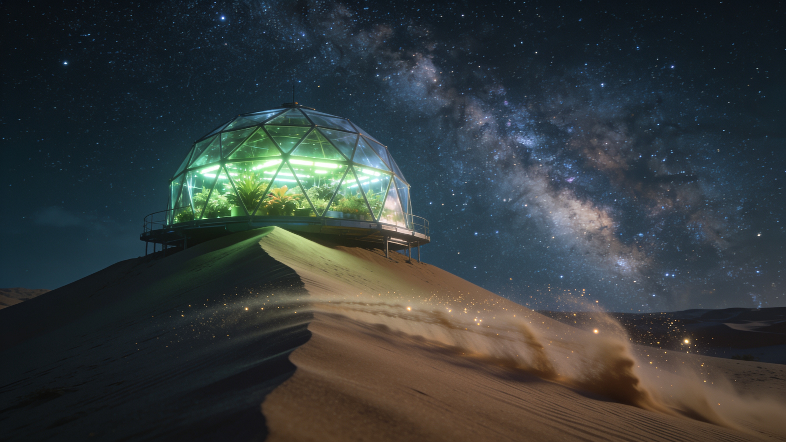

# Voice-to-Video Pipeline

Speak an idea into your microphone and get a fully scripted video. One OpenRouter API key powers every step: speech-to-text, script writing, image generation, text-to-speech, and video generation.

## Pipeline

| Step | Module | What It Does |
|---|---|---|
| 1 | `step01_speech.py` | Records the microphone and transcribes it |
| 2 | `step02_script.py` | Turns the idea into a JSON plan (title, narration, image prompt, video prompt) |
| 3 | `step03_image.py` | Generates a 16:9 cover image |
| 4 | `step04_voice.py` | Generates the voiceover (MP3) |
| 5 | `step05_video.py` | Generates a short video from the cover image and polls until it is ready |

`pipeline.py` runs all five steps, saves everything in a timestamped folder under `output/`, and prints a cost summary.

## Example

**Spoken Idea:** "A glass-domed greenhouse on a dune glows green under the Milky Way while sand streams across the ground in the wind."

### Terminal Output

```text
$ uv run python -m voice_to_video_pipeline.pipeline
[INFO - pipeline.py] 1/5 Getting your idea...

[input - step01_speech.py] Press Enter to START recording.

[INFO - step01_speech.py] Recording...

[input - step01_speech.py] Press Enter to STOP.

    - Idea: A glass-domed greenhouse on a dune glows green under the milky way while sand streams across the ground in the wind.

[INFO - pipeline.py] 2/5 Writing the plan...

    - Title: Oasis of Light

[INFO - pipeline.py] 3/5 Generating cover image...

[INFO - pipeline.py] 4/5 Generating voiceover...

[INFO - pipeline.py] 5/5 Generating video (this can take minutes)...

    - Video job gen-vid-1794099495-rzUjtwIicpm3W45f6til submitted.

    - Video job gen-vid-1794099495-rzUjtwIicpm3W45f6til status: pending

    - Video job gen-vid-1794099495-rzUjtwIicpm3W45f6til status: pending

    - Video job gen-vid-1794099495-rzUjtwIicpm3W45f6til status: pending

    - Video job gen-vid-1794099495-rzUjtwIicpm3W45f6til status: pending

    - Video job gen-vid-1794099495-rzUjtwIicpm3W45f6til status: pending

    - Video job gen-vid-1794099495-rzUjtwIicpm3W45f6til status: completed

    - Video: D:\python_projects\voice_to_video_pipeline\output\20261107_195735\video.mp4


Saved to D:\python_projects\voice_to_video_pipeline\output\20261107_195735


[INFO - client.py] Cost summary (USD)

    - speech-to-text $0.0001

    - script         $0.0000

    - image          $0.0400

    - video          $2.4000

    - TOTAL          $2.4401
```

### Cost of This Run

| Step | Cost (USD) |
|---|---|
| Speech-to-text | $0.0001 |
| Script | $0.0000 |
| Image | $0.0400 |
| Voiceover | not tracked |
| Video (6 s) | $2.4000 |
| **Total** | **$2.4401** |

### Plan

```text
TITLE:
Oasis of Light

NARRATION:
On a silent dune beneath the sprawling Milky Way, a glass dome pulses with emerald life. Golden sand ripples like water around its base, driven by a wind that carries the scent of distant stars.

IMAGE_PROMPT:
A 16:9 cinematic wide shot of a futuristic geodesic glass-domed greenhouse sitting atop a tall sand dune. The dome glows intensely with vibrant green grow-lights illuminating lush vegetation inside. The night sky is dominated by a breathtaking, highly detailed Milky Way galaxy arching overhead. In the foreground, streams of fine sand particles are blown horizontally across the dune surface by strong wind, catching starlight. Moody, atmospheric, hyper-realistic, 8k resolution, volumetric lighting.

VIDEO_PROMPT:
Camera starts low and wide, tracking slowly sideways (truck left) along the dune ridge. Fine sand streams horizontally across the immediate foreground in real-time motion, blurring slightly with shutter drag. The glass dome remains sharp, its green glow pulsing gently. Stars in the Milky Way rotate imperceptibly slow (timelapse effect) while the sand moves at normal speed. Wind disturbs the sand surface continuously. Cool blue moonlight contrasts with warm green interior light. High dynamic range, photorealistic fluid simulation for sand.
```

### Video

[](https://youtu.be/CV8aSfLNMrQ)

## Requirements

- Windows, macOS, or Linux with a working microphone
- [uv](https://docs.astral.sh/uv/) (it installs Python for you)
- An [OpenRouter](https://openrouter.ai/) account with credit and an API key

## Setup

```bash
git clone [https://github.com/](https://github.com/)<your-username>/voice_to_video_pipeline.git
cd voice_to_video_pipeline
uv sync
cp .env.example .env
```

Open `.env` and replace the placeholder with your real key:

```text
OPENROUTER_API_KEY=your_key_here
```

`.env` is ignored by Git and must never be committed.

## Usage

Run these from the project root.

```bash
# Speak your idea, stop before the expensive video step
uv run python -m voice_to_video_pipeline.pipeline --no-video

# Type your idea instead of speaking
uv run python -m voice_to_video_pipeline.pipeline --text "A lighthouse in a storm"

# Full run: idea -> plan -> image -> voiceover -> video
uv run python -m voice_to_video_pipeline.pipeline
```

Press Enter to start recording and Enter again to stop. Results are saved to `output/<timestamp>/` as `plan.txt`, `cover.jpg`, `voiceover.mp3`, and `video.mp4`.

## Models and Cost

Every model is set in `src/voice_to_video_pipeline/config.py`. Slugs and prices change over time, so check [OpenRouter's model list](https://openrouter.ai/models) before running. Video dominates the cost, and OpenRouter checks your credit balance against the maximum cost before it starts generating. Each run ends with a per-step cost summary, but the voiceover cost is not tracked.

## Project Structure

```text
voice_to_video_pipeline/

├── docs/example/
│   └── cover.jpg  # cover image used in this README
├── src/voice_to_video_pipeline/
│   ├── __init__.py
│   ├── client.py  # HTTP helper and cost tracker
│   ├── config.py  # models, paths, and API key
│   ├── pipeline.py
│   ├── step01_speech.py
│   ├── step02_script.py
│   ├── step03_image.py
│   ├── step04_voice.py
│   └── step05_video.py
├── tests/  # offline tests, no network or credit used
│   ├── conftest.py
│   └── test_pipeline_units.py
├── .env.example
├── .gitignore
├── .python-version
├── README.md
├── list_tts.py
├── pyproject.toml
└── uv.lock
```

## Testing

```bash
uv run pytest -v
```

The tests replace the network with fake responses, so they are free and need no API key.

## Notes

- Generated media is saved in `output/`, which is ignored by Git.
- Free text models can return malformed JSON, so the script step retries up to three times.
